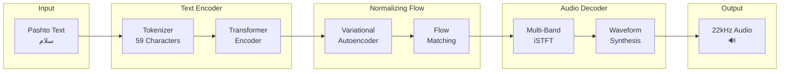

<p align="center">
  
  
  
  
  
</p>

<h1 align="center">Pashto Text-To-Speech Model</h1>

<p align="center">
  <strong>High-fidelity neural TTS for the Pashto language — trained from scratch on native speaker recordings</strong>
</p>

<p align="center">
  <a href="#-accuracy--accent">Accuracy</a> •
  <a href="#-listen-to-samples">Samples</a> •
  <a href="#-quick-start">Quick Start</a> •
  <a href="#-how-it-works">How It Works</a> •
  <a href="#-training-your-own">Train Your Own</a>
</p>

---

## Accuracy & Accent

<table>
<tr>
<td width="50%">

### 98% Word Accuracy

Verified by **native Pashto speakers** through listening tests:

- Clear pronunciation of Pashto-specific letters (`ښ ځ څ ړ ږ ګ ڼ ۍ ې`)
- Correct word boundaries and natural pauses
- Proper handling of common vocabulary
- Minimal consonant confusion

> *"It sounds like a real person speaking Pashto"*
> — Native speaker feedback

</td>
<td width="50%">

### Mangal Paktika Accent

This model speaks with the **Mangal Paktika** regional accent:

| Aspect | Detail |
|--------|--------|
| **Region** | Paktika Province, Afghanistan |
| **Dialect Group** | Southern Pashto |
| **Character** | Softer consonants, distinct vowel sounds |
| **Speaker** | Single native male speaker |

The accent is consistent throughout — ideal for applications requiring authentic regional speech.

</td>
</tr>
</table>

---

## Why This Model?

```
┌─────────────────────────────────────────────────────────────────────────────┐
│                         THE PROBLEM                                         │
├─────────────────────────────────────────────────────────────────────────────┤
│  • Very few TTS tools exist for Pashto                                      │
│  • Existing tools mispronounce Pashto-specific characters                   │
│  • No publicly available model for the Mangal Paktika accent                │
│  • Commercial APIs don't support Pashto well                                │
└─────────────────────────────────────────────────────────────────────────────┘
                                    ↓
┌─────────────────────────────────────────────────────────────────────────────┐
│                         THE SOLUTION                                        │
├─────────────────────────────────────────────────────────────────────────────┤
│  • 5,457 clean audio recordings from a native speaker                       │
│  • 8.4 hours of high-quality training data                                  │
│  • State-of-the-art MB-iSTFT-VITS2 architecture                             │
│  • 1,000 training epochs (~36 hours on RTX 4060 Ti)                         │
│  • Rigorous evaluation by native speakers                                   │
└─────────────────────────────────────────────────────────────────────────────┘
                                    ↓
┌─────────────────────────────────────────────────────────────────────────────┐
│                         THE RESULT                                          │
├─────────────────────────────────────────────────────────────────────────────┤
│  Type any Pashto text → Get natural Mangal Paktika speech in ~1 second      │
└─────────────────────────────────────────────────────────────────────────────┘
```

---

## Listen to Samples

> **No setup required** — just download and play the WAV files from [`samples/`](samples/)

| File | Pashto | English | Listen |
|------|--------|---------|--------|
| `01_salam.wav` | سلام | Hello | [Download](samples/01_salam.wav) |
| `02_manana.wav` | مننه | Thank you | [Download](samples/02_manana.wav) |
| `03_greeting.wav` | سلام، زه ستاسو سره مرسته کولی شم | Hello, I can help you | [Download](samples/03_greeting.wav) |
| `04_school.wav` | زه هره ورځ مکتب ته ځم | I go to school every day | [Download](samples/04_school.wav) |
| `05_pashto_history.wav` | دا زموږ د پښتو ژبې تاریخ دی | This is the history of our Pashto language | [Download](samples/05_pashto_history.wav) |
| `06_afghanistan.wav` | افغانستان یو ښکلی هېواد دی | Afghanistan is a beautiful country | [Download](samples/06_afghanistan.wav) |
| `07_peace.wav` | سوله او امنیت ډېر مهم دي | Peace and security are very important | [Download](samples/07_peace.wav) |
| `08_weather.wav` | نن ورځ هوا ډېره ښه ده | Today the weather is very good | [Download](samples/08_weather.wav) |
| `09_pashtun.wav` | زه پښتون یم او پښتو خبرې کوم | I am Pashtun and I speak Pashto | [Download](samples/09_pashtun.wav) |
| `10_education.wav` | زه غواړم چې ټول ماشومان مکتب ته ولاړ شي | I want all children to go to school | [Download](samples/10_education.wav) |

All samples generated with checkpoint `G_314000`, `noise_scale=0.4`.

---

## Quick Start

### Prerequisites

| Requirement | Version |
|-------------|---------|
| Python | 3.10+ |
| CUDA | 11.8+ |
| GPU VRAM | 4 GB minimum |

### Installation

```bash
# 1. Clone the repository
git clone https://github.com/Hussainm10/pashto-tts.git
cd pashto-tts

# 2. Create virtual environment
python -m venv venv
source venv/bin/activate  # Linux/Mac
# venv\Scripts\activate   # Windows

# 3. Install dependencies
pip install -r requirements.txt

# 4. Download the trained model (458 MB)
bash download_model.sh
# Or manually download from GitHub Releases → model/G_314000.pth

# 5. Download facial landmarks model
wget http://dlib.net/files/shape_predictor_68_face_landmarks.dat.bz2
bunzip2 shape_predictor_68_face_landmarks.dat.bz2
```

### Run the Demo

```bash
python app.py
# Opens at http://localhost:7860
```

Type any Pashto text, click **Generate**, and hear it spoken in the Mangal Paktika accent.

---

## How It Works

### Architecture: MB-iSTFT-VITS2



### Model Specifications

| Property | Value |
|----------|-------|
| **Architecture** | MB-iSTFT-VITS2 |
| **Parameters** | ~40 million |
| **Input** | Pashto Unicode text (59 supported characters) |
| **Output** | 22,050 Hz mono WAV |
| **Inference Speed** | ~1 second per sentence |

### Training Data

| Property | Value |
|----------|-------|
| **Source** | Native Mangal Paktika speaker |
| **Recordings** | 5,457 WAV files |
| **Duration** | 8.4 hours total |
| **Avg Clip Length** | ~5.5 seconds |
| **Sample Rate** | 22,050 Hz, mono |

### Training Configuration

| Setting | Value |
|---------|-------|
| **Epochs** | 1,000 |
| **Best Checkpoint** | Step 314,000 (epoch ~969) |
| **Batch Size** | 16 |
| **Learning Rate** | 2e-4 with decay |
| **GPU** | NVIDIA RTX 4060 Ti 16GB |
| **Training Time** | ~36 hours |

---

## Use in Python

```python
import torch
import json
from text import text_to_sequence
from text.symbols import symbols
from models import SynthesizerTrn
import commons
import scipy.io.wavfile as wavfile

# Load model
with open("configs/pashto.json") as f:
    hps = json.load(f)

net_g = SynthesizerTrn(
    len(symbols), 80,
    hps["train"]["segment_size"] // hps["data"]["hop_length"],
    n_speakers=hps["data"]["n_speakers"],
    **hps["model"],
).cuda()

checkpoint = torch.load("model/G_314000.pth", map_location="cpu")
net_g.load_state_dict(checkpoint["model"])
net_g.eval()

# Generate speech
text = "سلام، زه ستاسو سره مرسته کولی شم"
seq = text_to_sequence(text, ["pashto_cleaners"])
seq = commons.intersperse(seq, 0)

x = torch.LongTensor(seq).unsqueeze(0).cuda()
x_len = torch.LongTensor([len(seq)]).cuda()
sid = torch.LongTensor([0]).cuda()

with torch.no_grad():
    audio = net_g.infer(x, x_len, sid=sid, noise_scale=0.4)[0][0, 0]

wavfile.write("output.wav", 22050, audio.cpu().numpy())
```

---

## Supported Characters

The model supports **59 Pashto characters** including standard Arabic script letters and Pashto-specific characters:

```
Standard:  ا ب پ ت ث ج چ ح خ د ذ ر ز ژ س ش ص ض ط ظ ع غ ف ق ک ل م ن و ه ی
Pashto:    ښ ځ څ ړ ږ ګ ڼ ۍ ې ؤ ئ ة ۀ
Diacritics: ً ٌ ٍ َ ُ ِ ّ
```

> **Note:** Characters outside this set are silently ignored. If a word isn't spoken, it likely contains unsupported characters.

---

## Training Your Own Model

Want to train on a different accent or more data? See the full **[Training Guide](TRAINING_GUIDE.md)**.

### Quick Overview

```bash
# 1. Prepare data (WAV files + transcripts)
# Format: /path/to/audio.wav|0|پښتو متن

# 2. Update configs/pashto.json with your file paths

# 3. Train
python scripts/train_ms.py -c configs/pashto.json -m my_model

# 4. Monitor with TensorBoard
tensorboard --logdir logs/my_model
```

---

## Project Structure

```
pashto-tts/
├── app.py                  # Gradio web demo
├── download_model.sh       # Model download script
├── requirements.txt        # Python dependencies
│
├── model/
│   └── G_314000.pth        # Trained model (458 MB)
│
├── configs/
│   └── pashto.json         # Model configuration
│
├── text/
│   ├── symbols.py          # 59-character vocabulary
│   └── cleaners.py         # Text normalization
│
├── samples/                # Pre-generated audio samples
│
├── scripts/
│   ├── train_ms.py         # Training script
│   └── inference.py        # CLI inference
│
└── [model code]            # VITS2 implementation
    ├── models.py
    ├── modules.py
    ├── attentions.py
    └── ...
```

---

## Comparison with Other Approaches

| Approach | Accuracy | Speed | Status |
|----------|----------|-------|--------|
| **This Model (VITS2)** | **98%** | **~1s/sentence** | Production ready |
| Orpheus TTS (Llama-3B LoRA) | — | ~107s/sentence | Not fully trained |
| F5-TTS | — | — | Only 28% trained |

VITS2 was selected for its combination of **quality**, **speed**, and **stability**.

---

## Limitations

| Limitation | Detail |
|------------|--------|
| **Single Accent** | Mangal Paktika only — may sound unnatural for Kandahari, Peshawar dialects |
| **Vocabulary** | Works best with words seen during training |
| **Single Speaker** | No voice cloning or speaker selection |
| **GPU Required** | CUDA GPU needed for reasonable inference speed |
| **Character Set** | 59 characters only — unsupported chars are dropped |

---

## Author

<p>
  <b>Hussain Mansoor Bhutto</b> — Architect & Developer<br/>
  <a href="https://github.com/Hussainm10">GitHub</a> •
  <a href="https://www.linkedin.com/in/hussainmansoorbhutto/">LinkedIn</a>
</p>

---

## License

Code released under MIT License. Model weights and audio samples for research and educational use.

Based on [MB-iSTFT-VITS2](https://github.com/MasayaKawamura/MB-iSTFT-VITS2).

---

<p align="center">
  <sub>Making Pashto accessible through AI</sub>
</p>
